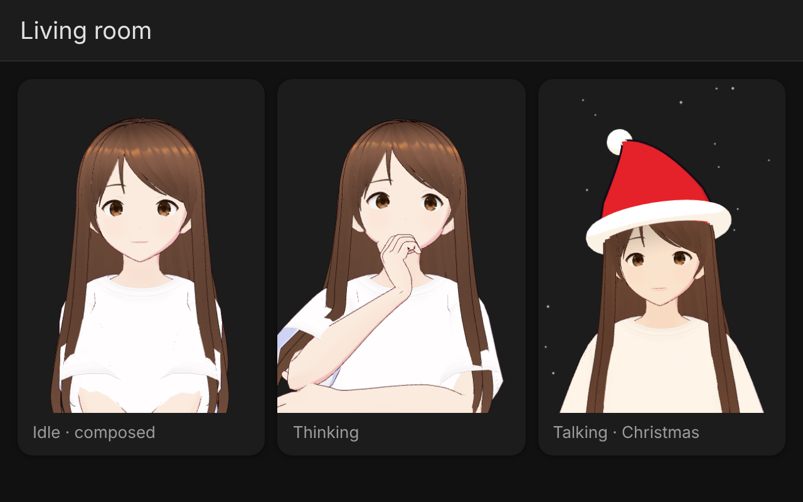

# VRM Assist Avatar Card

<p align="center"></p>

[](https://my.home-assistant.io/redirect/hacs_repository/?owner=Diess-tech&repository=vrm-assist-avatar-card&category=plugin)
[](https://github.com/Diess-tech/vrm-assist-avatar-card/releases)
[](https://github.com/Diess-tech/vrm-assist-avatar-card/releases)
[](LICENSE)

<a href="https://buymeacoffee.com/diesstech"></a>
<a href="https://ko-fi.com/diesstech"></a>
<a href="https://paypal.me/diesstech"></a>

A Lovelace card that shows a **3D VRM character** (for example one made with **VRoid Studio**) that **listens, thinks
and talks** along with your **Assist voice satellite**, like a desktop mascot for your dashboard.



- **Follows your voice satellite**: idle, listening, thinking and talking, with smooth transitions.
- Breathing, blinking, gaze, small gestures and a talking mouth, all computed: **works without any animation file**.
- Three **attitudes**: serious (arms crossed), playful (anime funny faces, winks), composed (hands together).
- **Moods and actions from helpers**: happy, sad, surprised, angry, tired, thoughtful, scared; wave, bow, wink, dance.
- **Several models**, switched from a helper without reloading the page.
- Optional **Mixamo clips** for more natural movement (you download them yourself, see below).
- **Overlay mode**: the character sits in a corner over the dashboard, with a transparent background.
- **Holiday themes**: a witch hat at Halloween, a Santa hat and snow at Christmas, automatically by date.
- Visual editor in **English and Italian**, with a button that creates the helpers for you.

## Installation

[](https://my.home-assistant.io/redirect/hacs_repository/?owner=Diess-tech&repository=vrm-assist-avatar-card&category=plugin)

Click the button above, or do it by hand:

1. In HACS, open the menu ⋮ → **Custom repositories**.
2. Add `https://github.com/Diess-tech/vrm-assist-avatar-card` with type **Dashboard** (or *Lovelace*).
3. Search for **VRM Assist Avatar Card**, download it and reload the browser.

### Manual

1. Download `vrm-assist-avatar-card.js` from the [latest release](https://github.com/Diess-tech/vrm-assist-avatar-card/releases)
   and copy it to `config/www/`.
2. Settings → Dashboards → ⋮ → **Resources** → add `/local/vrm-assist-avatar-card.js` as a **JavaScript module**.
3. Reload the browser. When you update the file, add `?v=2` (then `?v=3`…) to the resource address, otherwise the
   browser keeps the old copy.

## Setup

1. Edit a dashboard → **Add card** → **VRM Assist Avatar**. The card starts with the **example model**, so you see it
   right away, and picks your voice satellite if you have one.
2. **Your own character:** export it from VRoid Studio as `.vrm`, copy it to `config/www/avatar/` (File editor, Samba
   or Studio Code Server) and in the editor choose **My .vrm file** → `/local/avatar/name.vrm`.
3. Optional: open **Character** to choose an attitude and let moods, actions or holiday themes follow a helper.
   If the helper is missing, the **Create the helper** button makes it with the right options (admin users only).

The example model is the official VRM 1.0 sample of [three-vrm](https://github.com/pixiv/three-vrm) (© pixiv Inc.,
redistribution allowed). It is downloaded from GitHub when the card starts; to keep everything local, copy the
`.vrm` into `config/www/` and choose **My .vrm file**.

## Options

Everything below can be set from the visual editor; YAML is shown for reference.

```yaml
type: custom:vrm-assist-avatar-card
entity: assist_satellite.living_room     # voice satellite to follow
model: esempio                           # "esempio" (or "example") = the example model, or /local/avatar/name.vrm
personality: composto                    # serio | spiritoso | composto (or serious | playful | composed)
height: 480px                            # default 480px; calc(100vh - 56px) = full screen
demo: false                              # test buttons for states, attitudes and models
```

| Option | Description |
|---|---|
| `entity` | `assist_satellite` entity. Without it the character stays idle. |
| `model` | Model address, or `esempio` / `example`. |
| `models` | List of `{ name, file, personality }`: several models (with `demo`, a button switches them). |
| `model_entity` | Helper whose state is the `name` of the model to show (e.g. `input_select.avatar_modello`). |
| `personality` | `serio`, `spiritoso`, `composto` (English names work too). |
| `personality_entity` | Helper with the attitude: the names above, `nessuno`/`none`, `automatico`/`automatic` (= the model's own). |
| `mood_entity` | Helper with the mood: `neutro`, `felice`, `triste`, `sorpreso`, `arrabbiato`, `stanco`, `pensieroso`, `impaurito` (or `neutral`, `happy`, `sad`, `surprised`, `angry`, `tired`, `thoughtful`, `scared`). |
| `action_entity` | Every change is a request: `saluto`/`wave`, `inchino`/`bow`, `occhiolino`/`wink`, `balla`/`dance`. An `input_button` waves. |
| `theme` | `nessuno` (default), `automatico` (Halloween 24 Oct–2 Nov, Christmas 8 Dec–6 Jan), `halloween`, `natale`. |
| `theme_entity` | Helper with the theme (wins over `theme`). |
| `animations` | `consigliate` (the Mixamo pack below) or your own list of clips (see below). |
| `anim_base` | Folder of the Mixamo pack, default `/local/avatar/anim/`. |
| `overlay` | `true` or `{ position: bottom-right, size: piccola \| media \| grande, everywhere: false }`. |
| `zoom`, `fps`, `shadow` | Size of the character (1 = normal), frames per second (default 30), shadow below (default true). |

The helpers created by the editor are `input_select.avatar_modello`, `avatar_umore`, `avatar_atteggiamento`,
`avatar_azione` and `avatar_tema`. You can use your own instead: write their names in the code editor.

### Overlay

With `overlay` the card draws nothing in its place: the character appears in a corner over the dashboard, in all its
views, with a transparent background, and taps go through to the cards below. With `everywhere: true` it stays on
every dashboard of that device. It hides while the Wallpanel screensaver is running.

### Mixamo clips (optional)

The card moves on its own, but real motion-capture clips look more natural. [Mixamo](https://www.mixamo.com) clips are
free to use but **may not be redistributed**, so you download them yourself (free Adobe account):

1. On mixamo.com search for each animation below. Download with **Format: FBX Binary**, **Skin: Without Skin**,
   **Frames per second: 30**.
2. Rename each file as in the first column and copy them all to `config/www/avatar/anim/`.
3. In the editor: **Animations** → **My Mixamo clips**, then **Check the files** tells you which ones are missing.
   Missing clips are simply skipped.

| File | Search on Mixamo | Used for |
|---|---|---|
| `breathing-idle.fbx` | Breathing Idle | idle |
| `weight-shift.fbx` | Weight Shift | idle |
| `briefcase-idle.fbx` | Briefcase Idle | idle (composed) |
| `happy-idle.fbx` | Happy Idle | idle |
| `looking-around.fbx` | Looking Around | gesture while idle |
| `yawn.fbx` | Yawn | gesture while idle |
| `arm-stretching.fbx` | Arm Stretching | gesture while idle |
| `bored.fbx` | Bored | gesture while idle |
| `head-nod-yes.fbx` | Head Nod Yes | listening |
| `acknowledging.fbx` | Acknowledging | listening |
| `lengthy-head-nod.fbx` | Lengthy Head Nod | listening |
| `thoughtful-head-shake.fbx` | Thoughtful Head Shake | thinking |
| `talking-1.fbx`, `talking-2.fbx`, `talking-3.fbx` | Talking (three different ones) | talking |
| `waving.fbx` | Waving | wave action |

### Your own clips

`animations` also takes a list per state: `riposo` (idle), `ascolta` (listening), `pensa` (thinking), `parla`
(talking), `gesti` (gestures while idle), `saluto`/`inchino`/`occhiolino`/`balla`/`tifo` (actions), one file or a list.
Formats: `.vrma`, Mixamo `.fbx`, `.glb`/`.gltf` with a Mixamo or Rigify skeleton (`file.glb#ClipName` picks one clip).
You can also group them by attitude (`serio:`, `spiritoso:`, `composto:`) or by mood (`felice:`, `triste:`…).

```yaml
animations:
  riposo: [/local/avatar/anim/idle1.vrma, /local/avatar/anim/idle2.vrma]
  parla: /local/avatar/anim/pack.glb#Idle_Talking_Loop
body: clip        # the body follows the clips only (the card keeps face, eyes and transitions)
```

## Notes

- The voice comes out of the satellite, not out of the dashboard device, so the mouth moves in a generic way while
  talking (no real lip sync).
- The character is shown from the waist up. Full body is planned once the feet stay really on the ground.
- 3D rendering uses the GPU: on old tablets lower `fps` to 15.

## 🇮🇹 In breve

Una card per Home Assistant che mostra un personaggio 3D in formato VRM (per esempio fatto con VRoid Studio) che
ascolta, pensa e parla insieme al satellite vocale di Assist. Si installa da HACS e si configura tutta dall'editor
grafico, in italiano: parte con un modello di esempio, poi si sceglie il proprio file `.vrm` copiato in
`config/www/avatar/`. Atteggiamenti, umori, azioni, temi delle feste e sovrimpressione in un angolo della dashboard;
gli aiutanti si creano con un pulsante. Le clip Mixamo sono facoltative e vanno scaricate da sé (non si possono
ridistribuire): l'elenco è nella tabella qui sopra.

## License

MIT © 2026 Davide Sanna. The Mixamo animation map comes from the three-vrm examples (MIT, © pixiv Inc.).
